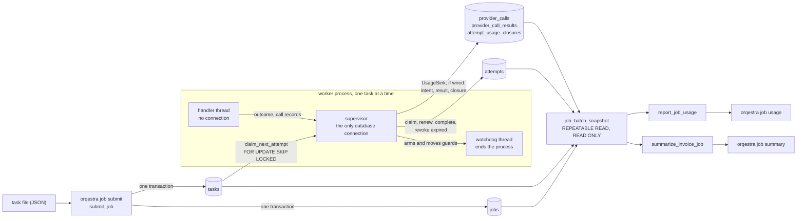
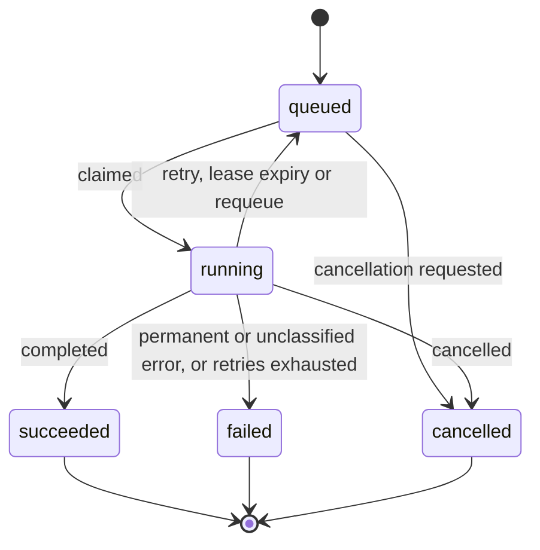
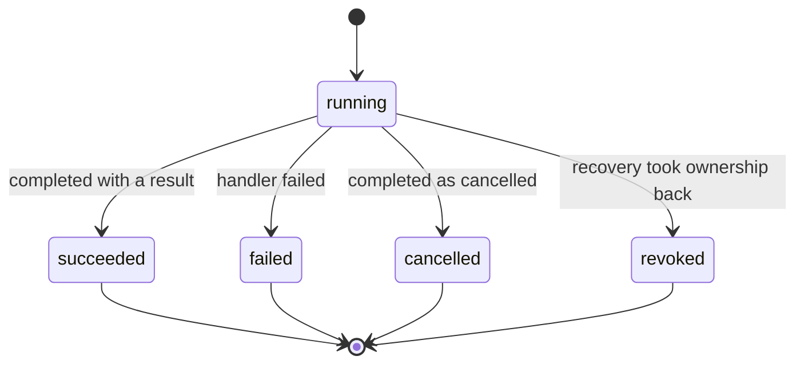
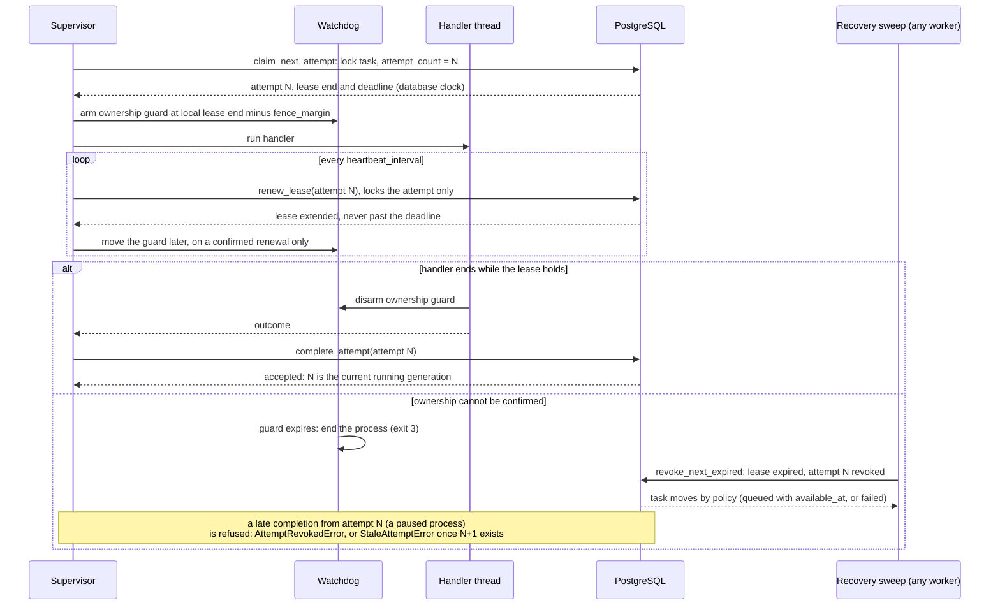

# Architecture

Orqestra is a Python library and command line that runs batch jobs with PostgreSQL as the
single source of truth. A job is split into tasks; each run of a task by a worker is an
attempt. This page shows how the parts fit together. The reasons behind each rule are in the
[decision log](decisions.md) and the [ADRs](adr/), and the limits of what is built are in the
README's [Known limitations](../README.md#known-limitations). This page links to them and does
not repeat them.

## Components

| Code | Role | Talks to the database |
| --- | --- | --- |
| [`domain`](../src/orqestra/domain/) | Pure rules: job and task records, the state tables, leases, retry policy, partitioning, job kinds | No |
| [`persistence`](../src/orqestra/persistence/) | Migrations, submission, the attempt lifecycle, the provider usage ledger and consistent snapshots | Yes, one short transaction per operation |
| [`worker`](../src/orqestra/worker/) | The single-slot worker: supervisor, handler thread, watchdog, usage sink, graceful shutdown | Through the supervisor only |
| [`calls`](../src/orqestra/calls/) and [`providers`](../src/orqestra/providers/) | The provider-neutral call contract, call recording and route selection; an OpenRouter adapter that is not wired in | No |
| [`workloads/invoice`](../src/orqestra/workloads/invoice/) | Synthetic invoice verification: deterministic checks first, a provider only for an ambiguous amount, and the job summary | No |
| [`aggregation`](../src/orqestra/aggregation/) | `summarize_invoice_job`, `report_job_usage` and the call budget check (`read_job_call_budget`, DEC-065), each from one snapshot | Read only |
| [`cli`](../src/orqestra/cli.py) | `orqestra version`, `health`, `migrate`, `worker run`, `job submit`, `job status`, `job summary` and `job usage` | Yes, except `version` and `health` |
| [`config`](../src/orqestra/config.py) | `Settings`: validated `ORQESTRA_*` settings with secrets redacted | No |
| [`logging`](../src/orqestra/logging.py) | One JSON object per log line, with job, task and attempt IDs when a call supplies them | No |
| [`benchmarks`](../benchmarks/) (not packaged) | The measurement harness: cells, ladders, claim cost, failure drills and the report tables | Only the dedicated `orqestra_bench` database |

## Data path

Everything a job does is a row. Submission writes the job and all of its tasks at once. A worker
claims a task, which writes an attempt; while the handler runs, the supervisor writes the
attempt's lease renewals and, in a worker built with a `UsageSink`, each provider call before and
after it is made. `orqestra worker run` builds its worker without one (it runs only the diagnostic
handlers); only the unpackaged benchmark workers and the process tests' worker wire it. Reports
never write: they read one `REPEATABLE READ, READ ONLY` snapshot.

- **Submission** ([`persistence/jobs.py`](../src/orqestra/persistence/jobs.py)): one READ
  COMMITTED transaction that stores everything or nothing. An idempotency key returns the stored
  job for the same request and refuses a different one (DEC-024, DEC-025, DEC-064).
- **Claims** ([`persistence/lifecycle.py`](../src/orqestra/persistence/lifecycle.py)): the first
  queued task of a kind the worker runs, whose `available_at` has passed, that no other
  transaction has locked. A claim never waits for a row lock (DEC-033, DEC-043, DEC-053).
- **The worker** ([`worker/runtime.py`](../src/orqestra/worker/runtime.py),
  [`worker/fence.py`](../src/orqestra/worker/fence.py)): the supervisor alone uses the
  database; the handler runs on its own thread; the watchdog ends the process when an armed
  deadline passes (DEC-045).
- **Usage** ([`worker/usage.py`](../src/orqestra/worker/usage.py)): in a worker with a
  `UsageSink`, an intent row commits before
  each provider call and a result row after it; the attempt's capture is closed in the
  transaction that ends it (DEC-057 to DEC-059).
- **Reports** ([`persistence/snapshots.py`](../src/orqestra/persistence/snapshots.py)): every
  read of one report sees the database as of the job-row read and takes no row lock
  (DEC-056, DEC-061).

## Task and attempt states

Both lifecycles are explicit, immutable tables in
[`domain/states.py`](../src/orqestra/domain/states.py) (`TASK_TRANSITIONS` and
`ATTEMPT_TRANSITIONS`), the single source of legal moves. The claim's discovery query takes its
`WHERE state = ANY(...)` filter from `TASK_TRANSITIONS` (`allowed_sources(TaskState.RUNNING)`);
every other lifecycle write locks its rows and then decides with `can_transition`, `transition`
and `transition_attempt` (DEC-028). The diagrams and tables below are
checked against those tables by
[`tests/unit/test_architecture_doc.py`](../tests/unit/test_architecture_doc.py): adding or
removing a move on either side fails it.

### Task

| From | To | When |
| --- | --- | --- |
| queued | running | a worker claims it |
| queued | cancelled | cancellation is requested while it waits for a claim |
| running | succeeded | the current attempt completes with a result |
| running | failed | a permanent or unclassified failure, or the last allowed attempt failed or was revoked |
| running | queued | a transient failure or a revoked attempt with attempts left; it waits until `available_at` |
| running | cancelled | the attempt completes as cancelled, or recovery revokes it after a cancellation request |

`succeeded`, `failed` and `cancelled` are final. A job has no stored state: its status is derived
from its tasks (DEC-022, DEC-031).

### Attempt

| From | To | When |
| --- | --- | --- |
| running | succeeded | the worker completes it with a result |
| running | failed | the worker reports a handler failure |
| running | cancelled | the worker completes it as cancelled |
| running | revoked | recovery commits a revocation after its lease expired |

An attempt is created running and ends exactly once. `revoked` is never reported by a worker
(DEC-038).

## Ownership

Attempt N of a task holds generation N, the task's `attempt_count` when it started. Only the
current, running generation can renew its lease or complete. Expiry only makes an attempt
eligible for recovery: ownership ends when recovery commits the revocation, so a completion that
commits first still counts (ADR-0003, DEC-029, DEC-037).

- **Claim with lease and deadline** (DEC-034, DEC-035): both are measured from one claim instant
  read from the database clock after the task lock. The deadline never moves, so a worker that
  keeps renewing a hung task is still bounded.
- **Heartbeat** (DEC-036): `renew_lease` locks only the attempt, so it cannot form a lock cycle
  with the task-first writers. It refuses an expired lease and a cancellation request.
- **Local fence** (DEC-045): a Python thread cannot be stopped, so the watchdog ends the whole
  process before the lease ends, by `fence_margin`. The guard moves only to a lease the database
  confirmed: a renewal, or a cancellation's grace end, earlier or later (DEC-068). A lost answer
  never moves it later.
- **Completion by generation** (DEC-029): `complete_attempt` takes effect only for the task's
  current running generation; any other write is rejected with a typed error and changes
  nothing.
- **Revocation** (DEC-037, DEC-038): one expired attempt per transaction, re-checked after its
  locks. A `cancellation_grace_expired` revocation cancels the task whatever retry budget is
  left (DEC-040). The other reasons follow the transient-failure rule: requeued while attempts
  remain, cancelled instead if a request is pending, and failed once the budget is used up,
  request or not (DEC-038).

## Invariants

- PostgreSQL holds every authoritative state; no process keeps one in memory (ADR-0003).
- Every lifecycle write is one short READ COMMITTED transaction that locks the task, then the
  attempt, decides with the domain tables and commits. The heartbeat is the one exception, and
  it locks the attempt only (DEC-021, DEC-028, DEC-036).
- No transaction stays open while a handler runs.
- Every instant that decides expiry comes from the database clock and is decoded in UTC whatever
  the session TimeZone (DEC-067).
- A provider call is made only after its intent row has committed (DEC-059).
- A report reads one snapshot and says whether its counts are final (DEC-056, DEC-061).

## Failure model

Execution is at least once. A task may run more than once; a completion is recorded at most once
per attempt, and only for the current generation.

| Failure | What happens |
| --- | --- |
| A worker process dies | Its lease expires; any live worker's sweep revokes the attempt and the task is retried by its policy |
| A supervisor database call stalls | The watchdog's operation guard ends the process (exit 4) |
| Ownership cannot be confirmed while a handler runs | The ownership guard or the supervisor ends the process (exit 3) |
| A handler raises a `BaseException` that is not an `Exception` (a control-plane signal) | Nothing is recorded and the process ends (exit 5); recovery takes the attempt after its lease (DEC-009) |
| A completion's answer is lost | The supervisor reconciles it from one read; the handler never runs again (DEC-047); if it is still unresolved at the attempt's deadline, the process ends (exit 6) |
| An outcome cannot be recorded before the attempt's deadline | The process ends (exit 8); recovery takes the attempt after its lease (DEC-046) |
| An invariant breaks, or the database rejects a valid outcome | The process ends as a defect (exit 7, DEC-046) |
| A worker is stopping | It claims nothing new and drains the task it holds, or ends at `shutdown_timeout` (exit 9, DEC-049) |
| A provider call record cannot be written | The fence ends the process first; exit 8 is the backstop (DEC-059) |
| A stale worker completes late | The write is refused with a typed error and changes nothing |

Recovery needs a live worker: there is no bound on recovery delay, only that every responsive
worker sweeps.

## Out of scope

- **No service.** Workers are independent processes started with `orqestra worker run`; nothing
  Orqestra owns supervises them (DEC-054).
- **No inbound API.** Jobs are submitted with the command line or the library (DEC-062).
- **No exactly-once execution.** A handler can run more than once for a task; its effects must
  tolerate that.

The full list of limits is the README's [Known limitations](../README.md#known-limitations).
